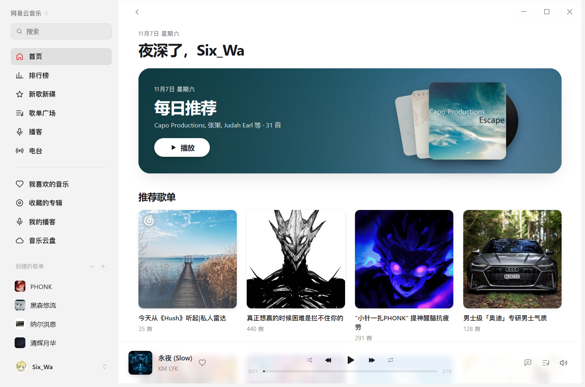

English | [中文](README_ZH.md)

# NetEase Cloud Music for MyGo Music

Plays NetEase Cloud Music in [MyGo Music](https://github.com/egoist/mygo-music): search, playlists, albums, artists, charts, the daily mix, lyrics, comments and your library.

It isn't affiliated with or endorsed by NetEase. It uses the private APIs of the website and client, which NetEase may change at any time; when it does, the plugin has to change too. Read the copyright and disclaimer at the end before using it.



## Install

Put the folder in the app's plugins directory — **Settings > Plugins > + > Show Plugins Folder** — or drop it in there.

To put it on GitHub instead, paste the repository URL in Settings > Plugins, or use the link:

```
mygo-music://install-plugin?repo=SixWa12138/mygo-music-netease-music
```

## Signing in

Click Sign In in **Settings > Plugins**: a QR code shows in the app. Scan it with the NetEase Cloud Music phone app, then confirm on the phone — that's the only way in.

The session cookie (with `MUSIC_U`) is kept unencrypted in the plugin's data on this machine, and is only sent to NetEase's `music.163.com` and `interfacepc.music.163.com`, never to the audio CDN. Signing out forgets it. To end the session on NetEase's side, remove this device in the account's security settings.

## What works

Signed out:

- Search for songs, albums, artists and playlists, with suggestions while typing
- Home: today's picks, recommended playlists, new songs, charts
- Charts, new releases, and the playlist square's hot playlists
- Album, artist and playlist pages
- Podcast recommendations, popular shows, search, episodes and playback
- Playing (128k / 320k; a VIP song is a 45-second preview)
- Lyrics, with translations when the service has them, and song comments
- A station of songs similar to the last one

Signed in:

- Your playlists, liked songs, recently played, saved albums
- Playing songs in your playlists that you uploaded to your personal cloud
- Podcast library tabs: subscribed, created, purchased, and liked voices; subscribing and unsubscribing
- A paged music cloud library, local file uploads, batch progress and cancellation, with refresh after upload
- The daily mix, and personal radio
- Liking and unliking, posting comments, liking comments
- Creating, renaming and deleting playlists, adding and removing songs, reordering them
- Saving playlists, saving albums, following artists
- Lossless (flac) when the account has it

Not done: videos, bulk cloud deletion, creating or purchasing new podcasts, listening together, the feed.

Plays are not reported back to NetEase, so its own listening charts don't move. The plugin keeps its own recent list of what was played on this machine.

## Sidebar layout

Discovery, charts, new releases, playlists, podcasts and radio appear above a divider. Liked songs, saved albums, subscribed podcasts and the music cloud follow the divider, with the created and saved playlist groups and their lists beneath those navigation entries.

The player needs to support plugin sidebar dividers and positioned playlist groups to show this order. The [host sidebar patch](patches/mygo-sidebar.patch) is one implementation; a player without these interfaces can still open ordinary plugin pages, but cannot show the divider or place playlist groups here.

The companion build also includes a [dynamic liked cover patch](patches/mygo-liked-cover.patch). Liked Songs uses the first song's album artwork and updates after successful likes or unlikes in this app. Empty lists and missing, loading or failed artwork show the heart placeholder.

## Cloud uploads and podcast tabs

The four podcast tabs and cloud upload button use the player's browse-tab, native file-picker and upload interfaces. The [cloud library host patch](patches/mygo-cloud-library.patch) is one implementation of these interfaces; the plugin does not require a particular player version as long as those interfaces remain compatible. If the controls disappear after an update, the player is no longer exposing the corresponding browse or upload capability to the plugin.

Upload Music accepts multiple MP3, AAC, WMA, WAV, OGG, M4A, APE, FLAC and CUE files. CUE sheets (including `.flac.cue`) split at TRACK / INDEX 01 boundaries. Each track is uploaded as a temporary FLAC with its title, artist, album and track number, then the temporary file is removed. Duplicate selections of the same track are deduplicated. References stay within the sheet's directory; choose audio elsewhere directly.

Uploads preserve the original bytes, show per-file progress, support cancellation, and report failures. Playback of M4A, AAC, WMA, WAV and APE uses FFmpeg from PATH to create a temporary FLAC after the full download; the temporary files are removed on close. FFmpeg is already installed on this machine.

## Sound

Playback addresses come from `interfacepc.music.163.com/eapi/song/enhance/player/url/v1`, the same official client API used by [sogud/mygo-music-netease](https://github.com/sogud/mygo-music-netease). No separate API service is needed. A track plays from the returned NetEase CDN address, with nothing converted: mp3 or flac as it is.

- standard: 128 kbps
- high: 320 kbps
- lossless: flac (with membership)

Signed out, or without membership, a VIP track comes back as a 45-second fragment. That's the service's own doing, not the plugin cutting it off.

If the primary playback endpoint fails or returns no playable address, the plugin tries the same official client's `/eapi/song/enhance/player/url` endpoint. Public catalog restrictions do not grey out your uploaded cloud copy; its audio quality depends on the file NetEase returns.

## Lyrics

NetEase's own LRC, together with the translation (`tlyric`) when there is one. The app times them.

## Why there's encryption in the code

The website and the desktop app encrypt their requests in two different ways, and the plugin has to speak both:

- `weapi`: comments, saving albums, following artists, creating and deleting playlists, reordering their tracks, recently played, the daily mix. AES-128-CBC twice, with the key wrapped in RSA.
- `eapi`: liking and unliking, the ids of liked songs, playback addresses, saving a playlist, renaming a playlist, adding and removing its songs, all through `interfacepc.music.163.com`. AES-128-ECB once, with an MD5 inside the text and login credentials in both the encrypted header and Cookie.

The plugin's runtime has MD5 and AES-ECB (`host.crypto`) but no AES-CBC, so `index.js` carries a small AES-128-CBC of its own; the S-box is computed over the field rather than typed out. The RSA key is fixed, so its result is worked out once and kept as the constant `encSecKey`: the service only cares that it can recover the key, not that it's a new one every time.

The `X-antiCheatToken` in `eapi` is a constant from the client, and may change when NetEase ships a new version.

## Known limits

- Both the endpoints and the encryption are private to NetEase; a change can break the plugin. Temporary environment or network risk errors require trying again later.
- Personal radio, your library, saving and commenting need a session; the daily mix is only yours when signed in.
- Regional licensing still applies: some songs are unplayable from some networks.
- A playlist over a thousand songs costs one more request when it opens, so it opens a little slower.
- Saving a playlist goes through `eapi` and the anti-cheat token, which a new client version can invalidate.

## Development checks

No build or dependency installation is needed. With Node.js 22 or newer, run `node --check index.js` and `node --test index.test.mjs`. The tests mock the API and do not read your local session.

## Copyright and disclaimer

**Not an official project.** This is a personal, third-party project. It is not affiliated with, endorsed by, sponsored by, or in any way connected to NetEase Cloud Music, NetEase, Inc. or its affiliates. It is not an official client, and it does not represent NetEase. The name "NetEase Cloud Music" is used only to say which service the plugin talks to. It is also not an official MyGo Music plugin, and has no affiliation with MyGo Music's author or maintainers.

**Trademarks.** "NetEase Cloud Music", "网易云音乐" and the related names, logos, icons and interface designs are trademarks and/or copyrighted works of NetEase or their respective owners. Their use here is nominative, to refer to the service, and claims no rights. This repository claims no copyright in the third-party assets visible in the screenshot.

**Content.** All music, audio, lyrics, translations, cover art, artist images, comments and other content reached through this plugin belong to NetEase Cloud Music and the respective rights holders — labels, songwriters, performers and others. Apart from the interface screenshot, this repository does not store, host, mirror or distribute any of it. The plugin runs on your own computer, with your own account, asks NetEase's own API for data, and hands the playback address the service returns to the player. The screenshot illustrates the interface; no audio or lyrics are shipped with this repository.

**No circumvention.** The plugin does not offer, and does not attempt, cracking, ad removal, bypassing payment, membership or regional restrictions, bulk downloading, or exporting audio or lyrics. Whether a track plays, at what bitrate, and for how long as a preview is decided entirely by NetEase's servers from your account and region; the plugin only passes on what the service answers.

**Scope of use.** For personal study, research and private use only. Do not use the plugin, or a modified version of it, commercially, as a public service, for bulk scraping, for hoarding data, for redistribution, or in any way that breaks NetEase's terms of service or the laws where you live. You are responsible for what you do with it.

**Account and privacy.** The plugin collects no analytics. Cloud uploads send only the audio files you select, or their CUE tracks, to NetEase's official `*.127.net` upload service; that service does not receive your session cookie. The cookie is kept in plain text in the plugin's data folder on your own machine, and is only sent to NetEase's `music.163.com` and `interfacepc.music.163.com`; signing out deletes it. Keep your computer and your account safe yourself.

**License.** The plugin's code is shared for personal study, research and private use; no other license is granted. To republish it, distribute a modified version, or use it commercially, ask the author first.

**No warranty.** Provided "as is", without any express or implied warranty, including availability, stability, legality or fitness for a particular purpose. The author is not liable for any direct or indirect loss arising from using, or being unable to use, this project.

**Notices and takedown.** No infringement is intended. If a rights holder believes something here — a name, a description or code — infringes their rights, please open an issue on the repository; the material will be changed or removed, and distribution stopped, once verified.

**Terms.** By using this project you confirm that you have read and accepted the above, and that you will follow NetEase's terms of service and copyright notice, and the laws of your country or region. If you do not agree, please do not use it.

