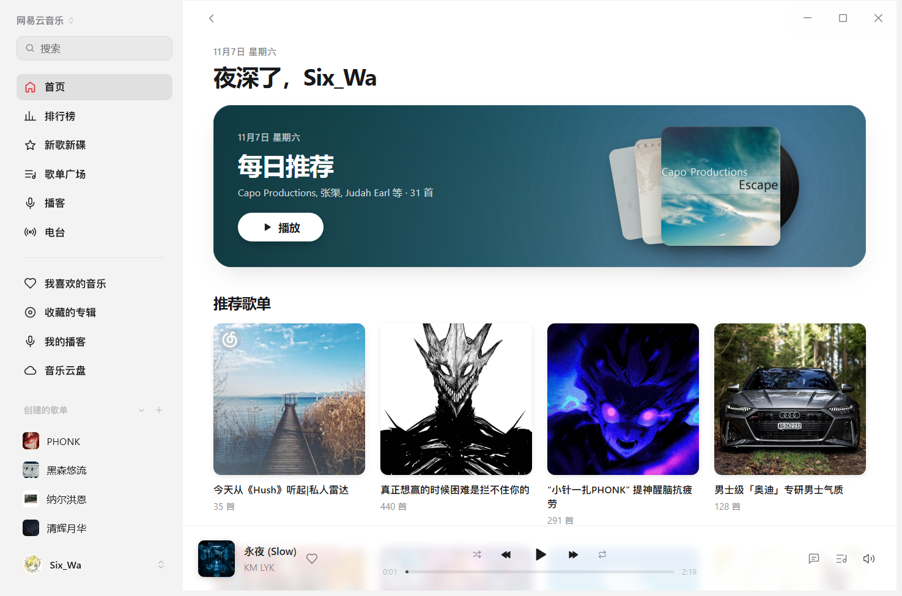

[English](README.md) | 中文

# 网易云音乐 for MyGo Music

在 [MyGo Music](https://github.com/egoist/mygo-music) 里听网易云音乐：搜索、歌单、专辑、歌手、排行榜、每日推荐、歌词、评论和我的音乐库。

它与网易云音乐没有关系，也没有得到它的认可。它用的是网页版和客户端的私有接口，网易云随时可能改动，改动了就得跟着改。使用之前，请先读文末的「版权与免责声明」。



## 安装

把整个文件夹放进 MyGo Music 的插件目录：**设置 > 插件 > + > 显示插件文件夹**，或者把文件夹拖进去。

在 GitHub 上放一份的话，也可以在 设置 > 插件 里直接粘贴仓库地址，或者用安装链接：

```
mygo-music://install-plugin?repo=SixWa12138/mygo-music-netease-music
```

## 登录

在 **设置 > 插件** 里点登录，对话框里会出现二维码：用网易云音乐手机 App 扫一扫，然后在手机上确认登录。

登录后的 cookie（含 `MUSIC_U`）以明文存在本机插件的设置数据里，只会发给网易云官方的 `music.163.com` 和 `interfacepc.music.163.com`，不会发给音频 CDN。点退出登录就会忘掉它；要彻底结束这次登录，到网易云音乐的「账号安全 > 登录设备管理」里把这一台移除。

## 能做什么

未登录：

- 搜索歌曲、专辑、歌手、歌单，以及搜索建议
- 首页的今日推荐、推荐歌单、新歌速递、排行榜
- 排行榜、新歌新碟、歌单广场（热门歌单）
- 专辑、歌手、歌单页面
- 播客推荐、热门播客、搜索、节目详情和播放
- 播放（128k / 320k；VIP 歌曲只有 45 秒试听）
- 歌词（有翻译就一起给）、歌曲评论
- 相似歌曲电台

登录之后：

- 我的歌单、我喜欢的音乐、最近播放、收藏的专辑
- 播放歌单中已上传到个人云盘的歌曲
- 我的播客：收藏播客、创建播客、购买播客、喜欢的声音，以及订阅/取消订阅
- 音乐云盘列表与翻页，上传本地音乐、批量上传进度与取消，成功后自动刷新
- 每日推荐、私人漫游
- 点赞 / 取消点赞，发表评论、给评论点赞
- 新建、改名、删除歌单，往里加歌、删歌、拖动排序
- 收藏歌单、收藏专辑、关注歌手
- 无损（flac）音质（需要会员）

不做的：MV、云盘批量删除管理、创建或购买新播客、一起听、动态。

播放记录不会写回网易云，所以网易云自己的「听歌排行」不会更新；插件会把在本机播过的歌记在自己的「最近播放」里。

## 侧栏布局

上方是发现音乐、排行榜、新歌新碟、歌单广场、播客和电台；分隔线下方依次是我喜欢的音乐、收藏的专辑、我的播客和音乐云盘。这些入口之后才是创建的歌单、收藏的歌单及其具体列表。

播放器需要支持插件侧栏分隔线和歌单组定位，才能按这里的顺序显示。本仓库提供 [播放器侧栏补丁](patches/mygo-sidebar.patch)；不支持这些接口的播放器仍可打开普通插件页面，但不能显示分隔线和指定的歌单组位置。

配套播放器还包含 [动态喜欢封面补丁](patches/mygo-liked-cover.patch)：“我喜欢的音乐”使用列表第一首歌曲的封面，在本机喜欢或取消喜欢成功后随列表更新。列表为空、首曲没有封面或封面未加载成功时显示爱心占位。

## 云盘上传与播客分类

四个播客页签和云盘上传按钮使用播放器提供的浏览页签、原生文件选择及上传接口。本仓库提供 [云盘与播客播放器补丁](patches/mygo-cloud-library.patch) 作为这些接口的一种实现；播放器更新后只要仍兼容这些接口，插件不要求特定版本。若按钮消失，表示当前播放器没有把对应能力提供给插件页面。

在音乐云盘点“上传音乐”，可多选 MP3、AAC、WMA、WAV、OGG、M4A、APE、FLAC 或 CUE。CUE（包括 `.flac.cue`）按 TRACK / INDEX 01 分轨，每首生成临时 FLAC 并独立上传，保留曲名、歌手、专辑和曲序，上传后清理临时文件；重复选择的同一曲目只加入一次。引用文件须在 CUE 所在目录内，其他位置请直接选择音频。

上传使用文件原始内容，显示当前文件和传输百分比，支持取消；已成功的文件会保留，失败项会显示原因。M4A、AAC、WMA、WAV、APE 等格式播放时使用 PATH 中的 FFmpeg 转成临时 FLAC，播放结束后清理，不更改原文件；这些格式需要先下载完整音频。本机已安装 FFmpeg。

## 声音

播放地址通过 `interfacepc.music.163.com/eapi/song/enhance/player/url/v1` 获取，与 [sogud/mygo-music-netease](https://github.com/sogud/mygo-music-netease) 使用同一个官方客户端 API 源，无需额外部署服务。直接播返回的网易云 CDN 地址，不转码，mp3 或 flac 原样交给播放器：

- 标准：128 kbps
- 较高：320 kbps
- 无损：flac（会员）

没登录、或者不是会员时，VIP 歌曲拿到的是 45 秒试听片段，这是网易云本身的行为，不是插件截的。

主播放接口报错或没有返回可用地址时，会尝试同一官方客户端的 `/eapi/song/enhance/player/url` 接口。个人云盘副本不会因公共曲库的版权标记而被置灰，音质以网易云返回的上传文件为准。

## 歌词

用网易云自己的 LRC，有翻译（`tlyric`）就一起给，应用会按时间对上。

## 为什么代码里有一份加密

网易云网页版和客户端对接口做了两套加密，插件都得会：

- `weapi`：评论、收藏专辑、关注歌手、新建/删除歌单、歌单排序、最近播放、每日推荐。两次 AES-128-CBC，再把 key 用 RSA 包一层。
- `eapi`：红心收藏/取消收藏、我喜欢的歌曲 id、播放地址、收藏歌单、改歌单名、增删歌曲，统一请求 `interfacepc.music.163.com`。AES-128-ECB 一次，文本里带 MD5 校验，登录凭据同时放在加密 header 和 Cookie 中。

插件运行的环境里只有 MD5 和 AES-ECB（`host.crypto`），没有现成的 AES-CBC，所以 `index.js` 里带了一份很小的 AES-128-CBC（S-box 是按有限域算出来的，不是抄 256 个数）。RSA 那一步的 key 是固定的，因此它的结果提前算好，写成了常量 `encSecKey`——服务端只关心能不能解出 key，不关心每次是不是新的。

`eapi` 里的 `X-antiCheatToken` 是客户端里的一个常量，网易云换版本时它可能会变。

## 已知限制

- 接口和加密方式都是网易云私有的，网易云一改，插件就可能失效；遇到“当前环境异常”或网络风控提示时，需要稍后重试。
- 私人漫游、我的音乐库、收藏、评论操作都需要登录；每日推荐登录之后才是按你口味的那一份。
- 地区版权仍然生效：海外网络下有些歌会变成不可播放。
- 歌单超过一千首时，插件会用歌曲 ID 再补一次详情，打开会比小歌单慢一点。
- 收藏歌单用的是客户端那套 eapi 和 anti-cheat token，网易云换客户端版本时它可能会失效。

## 开发检查

插件无需构建或安装依赖。使用 Node.js 22 或更新版本运行 `node --check index.js` 和 `node --test index.test.mjs`；测试使用模拟接口，不读取本机登录会话。

## 版权与免责声明

**非官方项目。** 本项目是第三方个人项目，与网易云音乐、网易公司（NetEase, Inc.）及其关联公司没有任何隶属、合作、授权或背书关系；它不是官方客户端，也不代表官方立场。名称中的「网易云音乐」只用于说明插件对接的是哪个服务。它同样不是 MyGo Music 的官方插件，与 MyGo Music 的作者和维护者没有隶属关系。

**商标。** 「网易云音乐」「NetEase Cloud Music」以及相关名称、图标、标识、界面设计等，其商标权、著作权及其他权利归网易公司或相应权利人所有。本项目对这些名称的使用仅是指称和说明，不构成任何权利主张；本仓库不主张截图中第三方素材的版权。

**内容版权。** 通过本插件访问的全部音乐、音频、歌词、翻译、封面、歌手图片、评论及其他内容，其著作权及邻接权归网易云音乐及相应的唱片公司、词曲作者、表演者等权利人所有。除界面截图外，本仓库不存储、不托管、不镜像、不分发任何上述内容：插件只是在你自己的电脑上、用你自己的账号，向网易云音乐的官方接口请求数据，并把服务端返回的播放地址交给播放器。截图仅用于展示界面，仓库不包含音频或歌词文件。

**不绕过任何限制。** 本插件不提供、也不试图提供破解、去广告、绕过付费 / 会员 / 地区限制、批量下载、导出音频或歌词的功能。一首歌能不能放、放到多高的码率、能试听多久，完全由网易云服务端根据你的账号和地区决定，插件只是如实转达服务端的回答。

**使用范围。** 本项目仅供个人学习、研究与自用。请勿把本插件或其修改版用于商业用途、公开服务、批量抓取、数据囤积、二次分发，或任何违反网易云音乐用户协议及所在地法律法规的用途。使用本项目产生的一切后果，由使用者自行承担。

**账号与隐私。** 插件不收集统计分析数据。云盘上传只把你选中的音频或其 CUE 分轨发送到网易云官方的 `*.127.net` 上传服务，不向该服务发送登录凭据。登录凭据（cookie）只以明文保存在你本机的插件数据目录里，只发送给网易云官方的 `music.163.com` 和 `interfacepc.music.163.com`；退出登录即删除。请自行保管好你的电脑和账号。

**许可。** 本仓库的插件代码可供个人学习、研究与自用；除此之外未授予任何许可。如需转载、发布修改版或用于商业用途，请先联系作者取得同意。

**无担保。** 本项目按「现状」提供，不附带任何明示或暗示的担保，包括但不限于可用性、稳定性、合法性或特定用途的适用性。作者不对因使用或无法使用本项目造成的任何直接或间接损失负责。

**权利通知与删除。** 本项目无意侵犯任何人的权利。如果任何权利人认为本仓库的内容（包括名称、说明文字或代码）侵犯了其合法权益，请通过仓库的 Issue 联系作者；作者会在核实后尽快修改或删除相关内容，并停止分发。

**遵守条款。** 使用本项目即表示你已阅读并同意上述说明，并承诺遵守网易云音乐的用户协议、版权声明以及你所在国家或地区的法律法规。如果你不同意，请不要使用。
